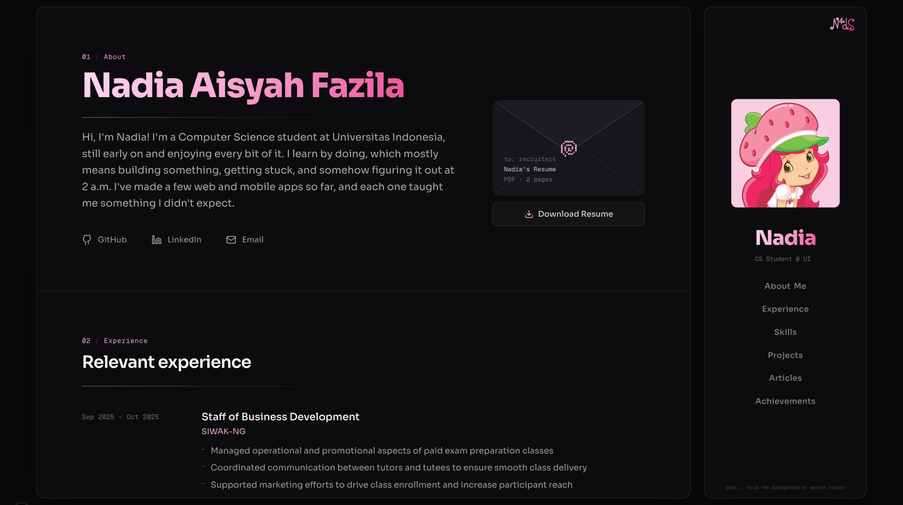

# Nadia's Portfolio

My personal portfolio: a single-page site about who I am, what I've worked on and what I've built.
I'm Nadia Aisyah Fazila, a Computer Science student at Universitas Indonesia.



## Sections

| Section | What's in it |
| --- | --- |
| **About** | A short intro, my links, and my resume in an envelope you can open |
| **Experience** | Organizations and roles I've been part of |
| **Skills** | My tech stack as layered waves of logos, one layer per category |
| **Projects** | A draggable carousel; each card opens a pop-up with the full write-up, my role, my contributions and links |
| **Writing** | Articles (coming soon) |
| **Achievements** | Stickers you can peel to see the certificate |

## Little details

- **Three color themes.** Hold down anywhere on the background to switch between pink, blue and purple.
- **Pixel art.** The seal, icons and award star are drawn as pixel bitmaps in the theme color.
- **Resume envelope.** Click to break the seal and slide the resume out, then click the paper to view or download it.
- **Peelable stickers.** Achievements peel at the corner on hover and open the certificate on click.

## Built with

- [Next.js 16](https://nextjs.org) (App Router) and React 19
- TypeScript
- Tailwind CSS 4
- Framer Motion
- [simple-icons](https://simpleicons.org) for the tech logos, [Lucide](https://lucide.dev) for UI icons
- Sora and Geist Mono fonts

## Running it locally

```bash
npm install
npm run dev
```

Then open [http://localhost:3000](http://localhost:3000).

Other scripts:

```bash
npm run build   # production build
npm run start   # serve the production build
npm run lint    # ESLint
```

## Updating the content

Most of the content is plain data, so updating it doesn't touch any components:

| What | Where |
| --- | --- |
| Projects (write-ups, roles, links, covers) | [`src/lib/projects.ts`](src/lib/projects.ts) |
| Tech stack | [`src/lib/tech-stack.ts`](src/lib/tech-stack.ts) |
| Color themes | [`src/lib/themes.ts`](src/lib/themes.ts) |
| Links, experience, articles and achievements | the arrays at the top of [`src/app/page.tsx`](src/app/page.tsx) |
| Project covers, certificates and resume | [`public/`](public) |

Project covers are imported in `projects.ts` rather than referenced by path, so replacing an image under `public/projects` with a file of the same name shows up right away.

## Project structure

```
src/
├── app/            # page, layout and global styles
├── components/     # envelope, project carousel and pop-up, tech stack, stickers, pixel art
│   └── ui/         # flickering grid, text decode and Skiper UI components
└── lib/            # content data: projects, tech stack, themes
public/             # images, certificates and the resume PDF
```

## Credits

Some interactions are adapted from [Skiper UI](https://skiper-ui.com) components (theme toggle, animated links and the side navigation), credited in their source files.
